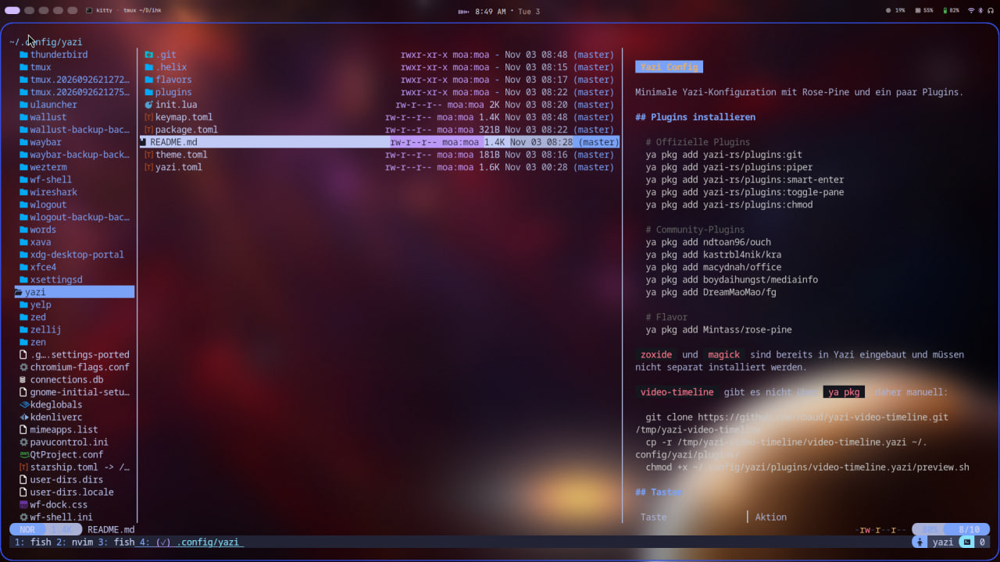

# Yazi Config

Minimale Yazi-Konfiguration mit Rose-Pine und ein paar Plugins.



## Plugins installieren

```bash
# Offizielle Plugins
ya pkg add yazi-rs/plugins:git
ya pkg add yazi-rs/plugins:piper
ya pkg add yazi-rs/plugins:smart-enter
ya pkg add yazi-rs/plugins:toggle-pane
ya pkg add yazi-rs/plugins:chmod

# Community-Plugins
ya pkg add ndtoan96/ouch
ya pkg add kastrbl4nik/kra
ya pkg add macydnah/office
ya pkg add boydaihungst/mediainfo
ya pkg add DreamMaoMao/fg

# Flavor
ya pkg add Mintass/rose-pine
```

`zoxide` und `magick` sind bereits in Yazi eingebaut und müssen nicht separat installiert werden.

`video-timeline` gibt es nicht über `ya pkg`, daher manuell:

```bash
git clone https://github.com/nbaud/yazi-video-timeline.git /tmp/yazi-video-timeline
cp -r /tmp/yazi-video-timeline/video-timeline.yazi ~/.config/yazi/plugins/
chmod +x ~/.config/yazi/plugins/video-timeline.yazi/preview.sh
```

## Tasten

| Taste | Aktion |
|---|---|
| `T` | Vorschau maximieren / wiederherstellen |
| `M` | Vorschau ein- / ausblenden |
| `l` | Ordner öffnen oder Datei öffnen |
| `F` | Dateisuche nach Inhalt (`rg` über `fg`) |
| `z` | Verzeichnis über `zoxide` wählen |
| `e` | Archiv entpacken |
| `C` | Komprimieren mit `ouch` |
| `Ctrl+d` | Drag and Drop |
| `A` | Neuen Ordner erstellen |
| `w`, dann `x` | Task-Manager öffnen / Task abbrechen |

> Hinweis: `M` ist in `keymap.toml` zusätzlich mit `chmod` belegt.
